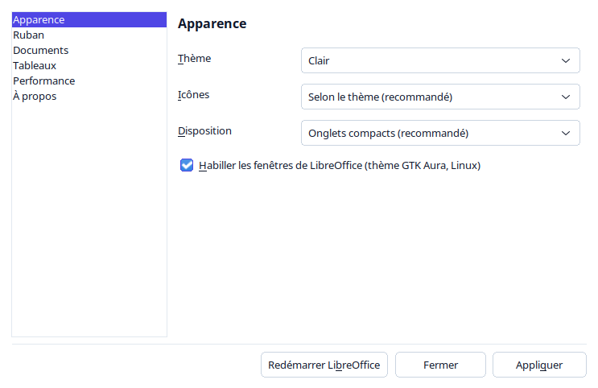
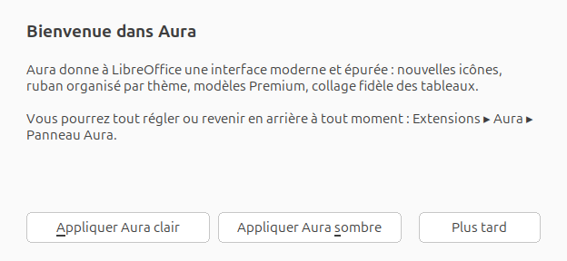
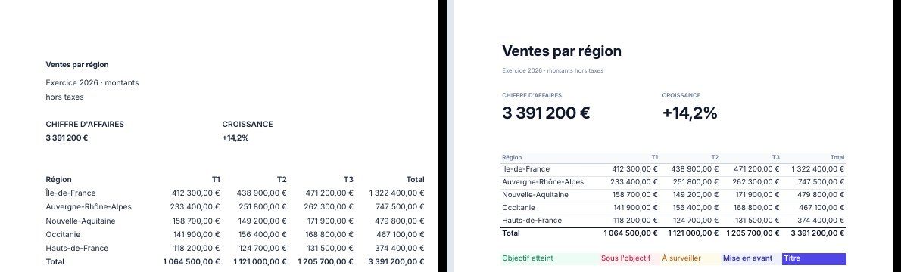
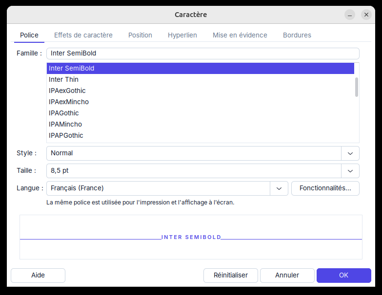
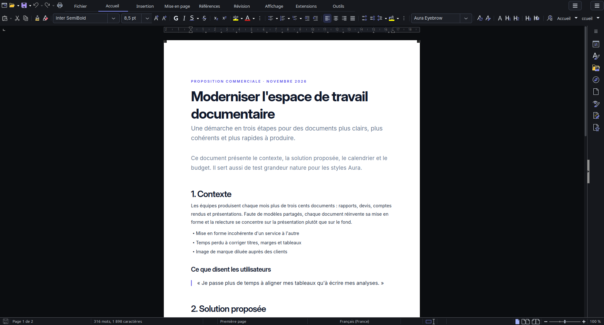
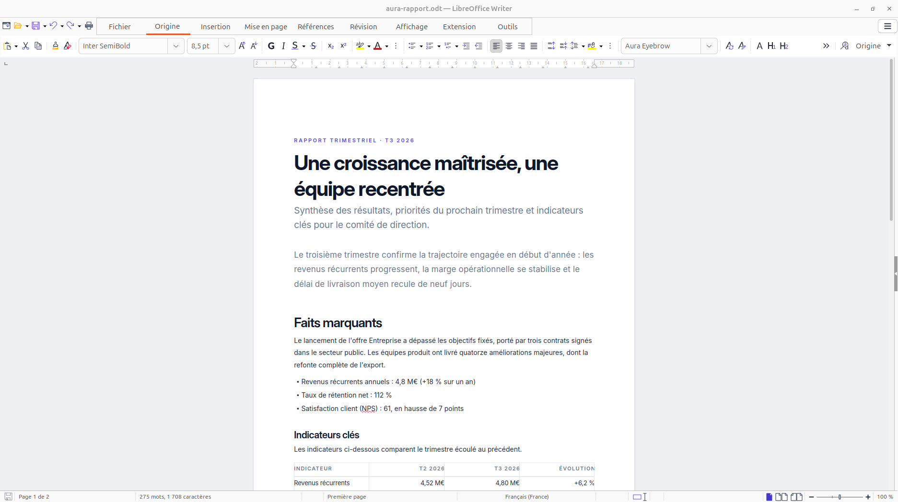
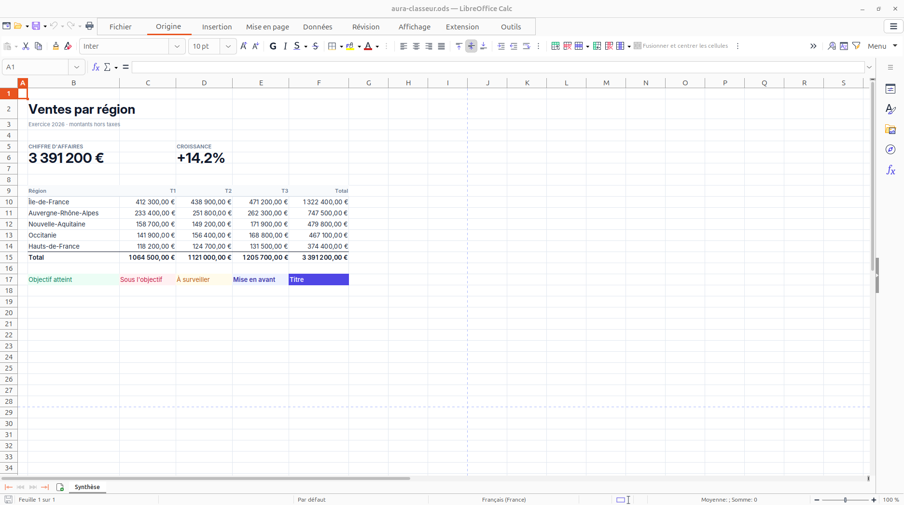
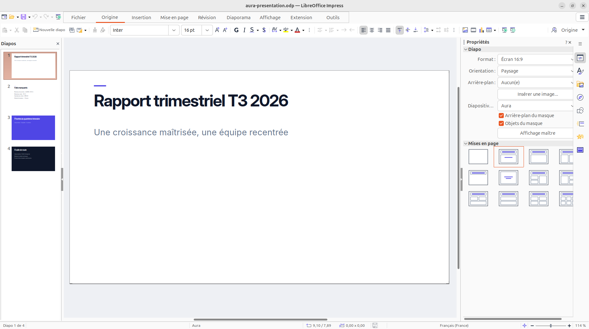
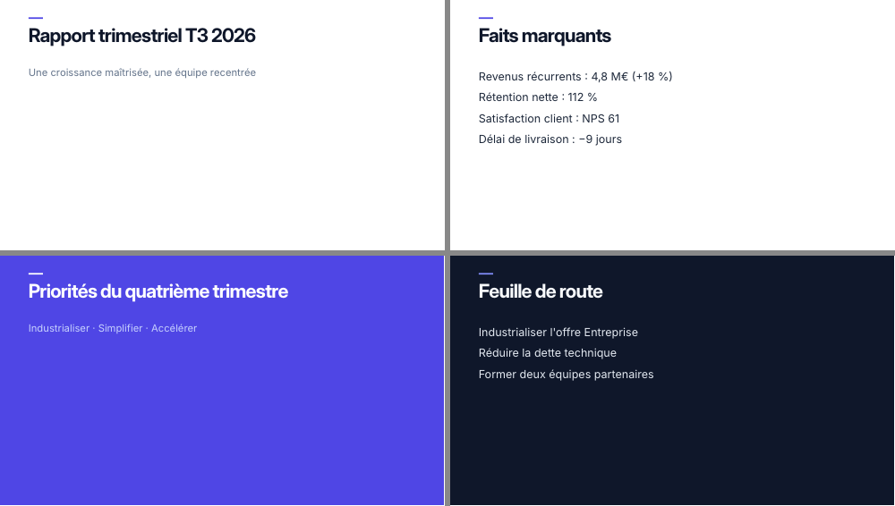

# Aura — une apparence moderne pour LibreOffice

**Aura** est une extension (`.oxt`) pour **LibreOffice ≥ 24.2** qui donne à Writer, Calc,
Impress et Draw une interface légère et épurée, et des documents d'un niveau Premium.

| | Ce qu'Aura apporte |
|---|---|
| **Icônes** | Thèmes *Aura* (clair) et *Aura dark* : les 4 520 icônes de LibreOffice redessinées dans une palette ardoise + indigo. Couverture complète, aucune icône manquante. |
| **Couleurs** | Schémas *Aura Light* / *Aura Dark* : fond d'application doux, page flottante sans traits de limites, grille Calc discrète, liens et repères en indigo. |
| **Windows, macOS, Linux** | Icônes, couleurs, ruban, onglet Extensions, modèles, collage de tableaux et mode clair/sombre natif de LibreOffice fonctionnent partout. La police **Inter** (OFL) est fournie et installée pour l'utilisateur si elle manque. |
| **Habillage (Linux)** | Thèmes GTK *Aura* / *Aura-dark* appliqués **à LibreOffice seul** : police Inter, surfaces blanches ou ardoise, accent indigo, champs et boutons arrondis, onglets soulignés, menus et infobulles redessinés, barres de défilement fines. Le reste du bureau n'est pas modifié. |
| **Ruban** | Onglets compacts réorganisés dans Writer, Calc, Impress et Draw. Les onglets trop chargés sont scindés par thème (*Formes*, *Paragraphe*, *Organiser*, *Bibliographie*, *Suivi des modifications*, *Cellules*, *Fenêtre*, *Diapos maîtresses*…) : **chaque outil est visible, sans chevron « » »**. Un contrôle au build garantit qu'aucune commande du ruban d'origine ne disparaît. |
| **Extensions** | L'onglet Extensions est reconstruit à partir des extensions installées : **un groupe titré par extension** (Zotero, TexMaths, Lecture vocale…), y compris celles qui ne déclarent que des barres d'outils (invisibles sinon en mode ruban), plus un groupe *Gérer* et un groupe *Aura*. Il se met à jour tout seul quand vous ajoutez ou retirez une extension. |
| **Tableaux** | **Ctrl+V dans Writer** colle une plage Calc, Excel ou web comme un vrai tableau qui garde bordures, fonds, polices, tailles, alignements, cellules fusionnées, largeurs de colonnes. *Outils ▸ Aura ▸ Coller le tableau* fait de même dans Impress et Draw. Le reste (texte, contenu Writer, collage dans un tableau) passe par le collage normal. |
| **Dictée vocale** | **Ctrl+Alt+Espace** (ou *Outils ▸ Aura ▸ Dictée vocale*) : vous parlez, le texte s'écrit au curseur dans Writer, dans la cellule dans Calc, dans la zone de texte dans Impress et Draw. **Anglais, français, espagnol, russe, japonais, yoruba, chinois**, avec détection automatique de la langue phrase par phrase. Ponctuation automatique, commandes vocales dans chaque langue (« nouveau paragraphe », « virgule », « efface ça », « 改行 », « новый абзац »…), espacement correct (aucun espace en japonais et en chinois, espace insécable en français). **100 % hors ligne** : reconnaissance Whisper (faster-whisper) sur la carte graphique NVIDIA si présente, Meta MMS en option pour le yoruba. Le moteur s'installe en un clic depuis le panneau Aura. |
| **Langue** | Les libellés des nouveaux onglets viennent des catalogues de traduction de LibreOffice : ils suivent **toutes les langues d'interface installées**, et le ruban se régénère au démarrage si vous changez de langue. Menus et messages d'Aura : français, anglais, allemand, espagnol, italien, portugais. |
| **Panneau Aura** | Un seul endroit pour tout régler, en six rubriques, avec *Appliquer*, *Redémarrer LibreOffice* et *Désinstaller proprement*. Chaque fonction peut être désactivée indépendamment. |
| **Compatibilité** | LibreOffice 24.2 et suivants : les rubans sont construits à partir du ruban **de la version installée** (retour automatique au ruban d'origine si une version future change sa structure) et reconstruits après chaque mise à jour, comme les icônes. Python 3.8+ (celui fourni avec LibreOffice), bibliothèque standard uniquement. |
| **Sécurité** | Aura ne supprime que ses propres fichiers à des emplacements connus (liste blanche), charge le presse-papiers sans macros ni liens, limite la taille des tableaux collés, ne construit aucune commande shell avec des données, et demande confirmation pour toute action destructrice. |
| **Léger** | Pas d'astuce du jour au démarrage, cache d'images porté à 600 Mo, barres d'outils remplacées par le ruban compact. |
| **Documents** | Modèles Writer, Calc et Impress : typographie Inter, hiérarchie de titres, tableaux à filets fins, styles de cellules (KPI, monétaire, total…), masques 16:9 clair / nuit / accent. |

## Installation

```bash
make install        # construit dist/Aura-<version>.oxt et l'installe avec unopkg
```

Ou : *Outils ▸ Gestionnaire des extensions ▸ Ajouter* et choisir `dist/Aura-<version>.oxt`.

Au premier lancement, Aura vous accueille et propose de s'appliquer en un clic. Ensuite, tout se règle
dans le **Panneau Aura** (onglet *Extensions* ▸ *Aura*, ou *Outils ▸ Aura ▸ Panneau Aura…*) : thème,
icônes, disposition, habillage, onglet Extensions, modèles, collage de tableaux, performance,
redémarrage, restauration et désinstallation propre. Sinon, **Outils ▸ Aura ▸ Appliquer Aura (clair | sombre)**, fermer complètement LibreOffice et le
relancer **depuis le menu des applications** (les lanceurs Aura démarrent LibreOffice avec le thème
GTK Aura ; lancé depuis un terminal, `GTK_THEME=Aura libreoffice`).
**Outils ▸ Aura ▸ Restaurer l'apparence d'origine** remet exactement vos réglages précédents
(ils sont sauvegardés dans `<profil>/user/libreappearance/backup.json`).

Police recommandée : [Inter](https://rsms.me/inter/) (OFL), avec *Inter Display*.

## Dictée vocale

*Panneau Aura ▸ Dictée vocale ▸ Installer le moteur* crée un environnement Python dans le profil
(`<profil>/user/libreappearance/voice/`) avec [faster-whisper](https://github.com/SYSTRAN/faster-whisper)
et télécharge le modèle. Il faut un Python 3.9 à 3.13 sur la machine (python.org sous Windows et macOS). La
reconnaissance se fait ensuite entièrement sur l'ordinateur.

| Précision | Modèle | Taille | Conseillé pour |
|---|---|---|---|
| Automatique | `large-v3-turbo` avec carte NVIDIA, sinon `small` | 1,6 / 0,5 Go | la plupart des cas |
| Très précis | `large-v3-turbo` | 1,6 Go | carte graphique, ou processeur récent |
| Maximal | `large-v3` | 3 Go | japonais, chinois, yoruba sur carte graphique |

Le **yoruba** est la langue la moins entraînée de Whisper : l'option *Meta MMS* (modèle `mms-1b-all`,
adaptateur `yor`, +3 Go) le reconnaît nettement mieux. Le **chinois** s'écrit en caractères simplifiés ou
traditionnels au choix. Le champ *Vocabulaire* donne au modèle les noms propres et termes techniques
à reconnaître.

Pendant la dictée, une petite fenêtre affiche l'état, le niveau du micro et le texte en cours de
reconnaissance (en direct sur carte graphique). Elle permet aussi de changer de langue ou de faire une pause.
Chaque phrase est une seule étape d'annulation : « efface ça » ou Ctrl+Z la retire entière.

| | Commandes (extraits) |
|---|---|
| English | new line · new paragraph · comma · period · question mark · delete that · undo · bold · stop dictation |
| Français | à la ligne · nouveau paragraphe · virgule · point · point d'interrogation · efface ça · annuler · gras · arrête la dictée |
| Español | nueva línea · punto y aparte · coma · abrir interrogación · borrar eso · deshacer · negrita · detener dictado |
| Русский | новая строка · новый абзац · запятая · точка · удалить это · отменить · жирный · остановить диктовку |
| 日本語 | 改行 · 新しい段落 · てん · まる · はてな · かぎかっこ · 削除 · 元に戻す · 音声入力停止 |
| 中文 | 换行 · 新段落 · 逗号 · 句号 · 问号 · 删除 · 撤销 · 加粗 · 停止听写 |
| Yorùbá | ìlà tuntun · ìpínrọ̀ tuntun · àmì ìdánudúró · àmì ìbéèrè · pa á rẹ́ · dúró |

Les commandes anglaises marchent dans toutes les langues. Vous pouvez ajouter vos propres formules dans
`<profil>/user/libreappearance/voice/commands.json`, par exemple
`{"yo": {"ìlà míràn": "newline"}, "fr": {"saut de section": "page_break"}}`.
La liste complète et les actions possibles sont dans
[aura_voice.py](src/extension/python/pythonpath/aura_voice.py).

## Construire

Prérequis : LibreOffice ≥ 24.2, un Python qui peut `import uno` (sous Debian/Ubuntu :
`/usr/bin/python3`, paquet `python3-uno`), `make`.

```bash
make            # icônes + schémas de couleurs + modèles + exemples, puis dist/Aura-<version>.oxt
make test       # analyse HTML (Excel), dictée (commandes et espacement dans les 7 langues),
                # appliquer / restaurer en profil jetable, et chaque commande des rubans
                # exécutée dans un document de son module
make test-voice # dictée de bout en bout : moteur Whisper réel -> texte dans Writer et Calc
                # (VOICE_VENV=<venv avec faster-whisper>)
make samples    # régénère seulement les modèles et build/samples/*.pdf pour la revue visuelle
```

### Windows et macOS

Le workflow [cross-platform](.github/workflows/cross-platform.yml) construit l'extension sous Ubuntu
24.04 (LibreOffice 24.2, la plus ancienne version prise en charge), puis l'installe et la teste sur de
vraies machines GitHub : **Windows** et **macOS**, chacun avec la dernière version de LibreOffice et la
précédente, et Linux 24.2. Il s'exécute à chaque `git push` (onglet *Actions* du dépôt).

Pour tester à la main sur une machine Windows ou macOS, avec le Python fourni par LibreOffice :

```
"C:\Program Files\LibreOffice\program\python.exe" tools\test_extension.py
/Applications/LibreOffice.app/Contents/Resources/python tools/test_extension.py
```

Toutes les couleurs et polices viennent de [design/tokens.json](design/tokens.json) : modifier
un token puis `make` met à jour icônes, couleurs d'application et modèles d'un coup.

Voir [docs/ARCHITECTURE.md](docs/ARCHITECTURE.md) pour le fonctionnement interne.

## Licences

Code : MIT (voir [LICENSE](LICENSE)). Les thèmes d'icônes sont dérivés de Colibre
(© The Document Foundation, CC BY-SA 4.0) et restent sous CC BY-SA 4.0. La police Inter
(© The Inter Project Authors) est distribuée sous SIL Open Font License 1.1.

## Aperçu












